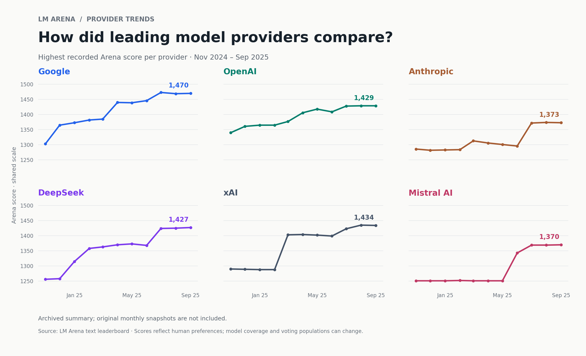

# LM Arena · Model Provider Trends

**A Python data visualization project exploring how the highest recorded text-leaderboard scores changed across six AI providers.**

AI leaderboards offer a snapshot of a fast-moving field. I built this project to make that history easier to explore: organize monthly scores, compare providers on the same scale, and turn a table of results into a readable visual story.

The included summary spans **November 2024 through September 2025** and covers Google, OpenAI, Anthropic, DeepSeek, xAI, and Mistral AI. The project focuses on data preparation and visualization with **Python, Pandas, and Matplotlib**. Earlier animation experiments are preserved in `archive/`.



## What the chart shows

Each panel follows one provider, using the same date range and score scale. Each observation represents the **highest recorded Arena score among that provider's models** in the monthly summary, not an average of its models. A provider's leading model can change from month to month.

Separate panels make closely spaced series easier to read without hiding their relative levels. Endpoint labels show the last month's score; the CSV remains available for inspecting individual values.

This is an exploration of published leaderboard results, not a new model benchmark or an evaluation of autonomous agents. It can help frame questions about the AI landscape, but it does not measure market share, revenue, or suitability for a particular application.

## Run locally

Python 3.10 or newer is required. No Node.js or web server is needed.

```bash
python -m venv .venv
source .venv/bin/activate  # Windows: .venv\Scripts\activate
python -m pip install -r requirements.txt
python lmarena_data/process_lmarena_data.py
```

The default command reads the committed summary and writes two files to `lmarena_data/output/`:

- `provider_scores.csv` — the validated, date-sorted summary.
- `provider_trends.png` — the six-panel chart shown above.

Paths are resolved relative to the script, so it also works when launched from another directory. To choose a destination:

```bash
python lmarena_data/process_lmarena_data.py --output-dir /tmp/arena-charts
```

## Data and reproducibility

The original project attributed its data to the [LM Arena leaderboard](https://lmarena.ai/). Two CSV files are preserved:

| File | Contents | Reproducibility |
| --- | --- | --- |
| `lmarena_top_scores_by_provider.csv` | 11 monthly observations for six providers | Enough to regenerate the visualization; not enough to audit every historical observation. |
| `lmarena_latest.csv` | A model-level snapshot, including organizations, scores, vote counts, and confidence-interval text | Retained for reference. This is a historical file, not a live download despite its original name. |

**The original monthly source snapshots and their exact retrieval dates were not committed.** The current chart therefore reproduces the archived summary, not the original collection process. The old processor carried forward a provider's previous score when it was absent from a snapshot; without those source files, it is not possible to identify which summary cells were affected. The archived values are preserved unchanged.

### Rebuild from monthly snapshots

If you have the source exports, place them in a directory with filenames such as `monthly_2025.01.csv`. Each file must contain `organization` and `arena_score` columns.

```bash
python lmarena_data/process_lmarena_data.py \
  --snapshots-dir /path/to/monthly-exports \
  --output-dir /tmp/arena-rebuilt
```

The processor matches the six providers, treats `Mistral` and `Mistral AI` as aliases, and takes each provider's maximum numeric score. Missing providers and missing months remain gaps. Malformed inputs fail with an error instead of being silently skipped. Newly generated output never overwrites the archived input CSVs by default.

## Reading the results responsibly

- Arena scores summarize human preferences in pairwise comparisons. They are not percentages or universal measures of model quality.
- The best-scoring model, available competitors, and voting population can change between snapshots. A change in score is not a controlled measurement of capability improvement.
- The historical summary does not include per-observation uncertainty or vote counts. Small differences should not be treated as statistically meaningful wins.
- Missing historical source files limit verification. The animation exports are legacy presentation artifacts and are not regenerated by the Python script.

## Repository guide

```text
lmarena_data/
  process_lmarena_data.py             # Validation, optional aggregation, plotting
  lmarena_top_scores_by_provider.csv  # Preserved historical summary
  lmarena_latest.csv                  # Preserved model-level snapshot
  provider_trends.png                 # README preview
  lmarena_real_historical_chart.png   # Original chart, retained for reference
archive/
  lmarena_racing_chart.gif            # Original animation export
  Flourish Demo Video.mov            # Original Flourish demo
requirements.txt
```

Built by [Rahul Kumar](https://github.com/rahulbkumar).

## Checks

```bash
python -m unittest discover -s tests -v
```

The checks cover missing months and providers, provider aliases, invalid scores, duplicate dates, and absent snapshot files.
